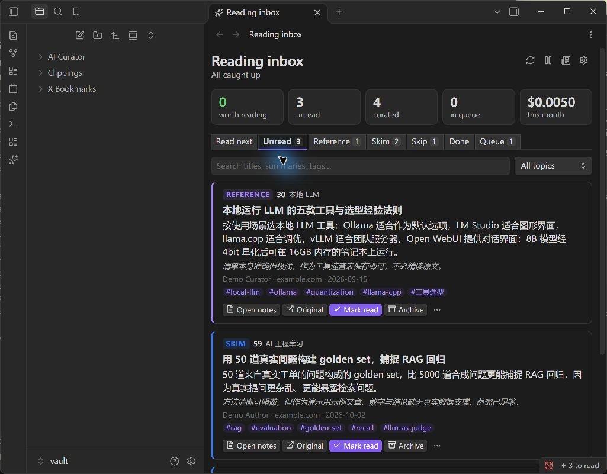

# AI Curator for Obsidian

**Save anything. Read what matters.**

[简体中文](README.zh-CN.md) · [Download 1.0.0](https://github.com/MartinZhong2026/Obsidian-AI-Curator/releases/tag/1.0.0) · [Feedback](https://github.com/MartinZhong2026/Obsidian-AI-Curator/issues)

Turn saved articles and bookmarks into a reading inbox you can actually use. AI Curator reads Markdown in folders you choose, recommends **Read / Skim / Reference / Skip**, and writes concise notes with ideas, caveats and next actions.



*Demo screenshot from the earlier beta. Version 1.0.0 also includes a Simplified Chinese interface.*

- **Decide what deserves your time.** A verdict, reason and locally computed score.
- **Keep useful knowledge.** TL;DR, key ideas, practical steps and action checkboxes in English or Chinese.
- **Read in one place.** Search, topic filters, read/archive controls, a Bases list and weekly digests.
- **Connect notes locally.** Related links use shared topics, tags and tools without another AI call.
- **Keep your workflow.** Web Clipper, X bookmark tools and other Markdown exporters; no Python or background service.
- **Keep your originals.** Sources are never changed. Your writing below the marker in curated notes survives regeneration.

## Install

Requires **Obsidian 1.11.4+**. Distributed through GitHub and BRAT; **not yet listed in Obsidian's community directory**.

1. Download `ai-curator-1.0.0.zip` from the [release](https://github.com/MartinZhong2026/Obsidian-AI-Curator/releases/tag/1.0.0).
2. Extract into `<vault>/.obsidian/plugins/`. You should get:
   ```text
   .obsidian/plugins/ai-curator/
   ├── main.js
   ├── manifest.json
   └── styles.css
   ```
3. Reload Obsidian and enable **AI Curator** in *Settings → Community plugins*.

The release includes separate plugin files and `SHA256SUMS.txt`. Keep your usual vault backup.

**BRAT alternative:** install BRAT from Obsidian's community plugins, run **Add a beta plugin for testing**, enter `MartinZhong2026/Obsidian-AI-Curator`, and enable AI Curator. That BRAT command can install this stable release too.

## First two minutes

1. **Choose source folders** such as `Clippings` or your X bookmark folder. Existing notes wait for approval.
2. **Connect a provider.** DeepSeek is preselected; paste your own key and use **Test**, or choose another provider.
3. **Choose languages and interests.** The interface follows Obsidian by default. **Interface language** offers English and 简体中文; the note output language is independent. Your optional profile helps assess relevance.
4. **Review network options.** Full-text recovery is on by default and contacts the original website. X expansion uses third-party FxTwitter and is off until you enable it.
5. **Choose the backlog:** newest 10, all existing saves, or new saves only.

Open the ✦ ribbon icon for the inbox. New saves settle before processing, usually within a minute while Obsidian is open. Turning off automatic curation leaves **Process queue now** available.

## Notes and verdicts

Notes include a verdict and reason, TL;DR, summary, key ideas, how-to steps, caveats, actions, mentioned tools and related notes, with a link back to the saved source. See [English examples](docs/examples/en/) and [Chinese examples](docs/examples/zh/): real model outputs on synthetic demo material. Results vary between runs.

Scores use relevance (30%), depth (20%), actionability (20%), evidence (15%) and originality (15%). Popularity metrics do not affect scores. Incomplete saves are labeled and capped at 55/100. AI judgments can be wrong; check the original when accuracy matters.

```text
AI Curator/
├── Notes/             curated Markdown: verdict, score, topic, tags, status
├── Digests/           reading digests, created on request
└── Reading list.base  Read next, Unread, All curated and Reference views
```

## Providers and spending

| Provider | Setup |
|---|---|
| DeepSeek | Default; bring your API key |
| Anthropic Claude | Official SDK; key and an available model |
| OpenAI, Gemini, OpenRouter | Key and model name; use **Load models** |
| Ollama, LM Studio | A running local server and model |
| Custom | OpenAI-compatible `/chat/completions` endpoint |

Remote endpoints require **HTTPS**. HTTP is allowed only on `localhost`, `127.0.0.1` and `[::1]`, even for local presets. On mobile, localhost means the phone; a desktop model needs a reachable HTTPS endpoint.

Default limits: **US$3 estimated monthly budget**, **100 items/day**. Concurrent calls reserve the requested output allowance; duplicate saves share an analysis. Costs depend on tokens and provider prices. For models without a built-in price, enter input/output prices for meaningful budget tracking.

**This is not a hard billing cap.** Unknown prices, billed failures, tokenization differences and provider price changes affect actual charges. Set a provider-side spending limit when needed. Connection tests are not included in the curation counter.

Fully offline use requires a local model **and both full-text recovery and X expansion disabled**.

## Privacy and control

- Only chosen folders and notes you explicitly curate are analyzed. Output is excluded.
- The selected AI provider receives note text and metadata, optional profile, and existing topic/tag names; text may include recovered web content.
- Keys use Obsidian SecretStorage. Settings keep a secret identifier; provider errors redact the configured key.
- Queue state and analysis results stay in plugin storage, with recovery copies. Originals are never changed.
- No telemetry, analytics or AI Curator account. A one-time optional star invitation only opens GitHub when clicked.
- Saved content is untrusted data. Model output is validated; its instructions are never executed.

See the complete [privacy and network disclosure](docs/PRIVACY.md).

## Commands

**Open reading inbox** · **Process queue now** · **Pause or resume automatic curation** · **Curate the current note** · **Create weekly reading digest** · **Refresh related links in curated notes** · **Retry failed items** · **Open setup guide**

Digests and related-link refreshes do not call AI. Single-note curation works outside watched folders. Reload after switching interface language to update command names.

## Troubleshooting and limits

- **Nothing happens:** inspect Queue, key/model, pause state and limits; new files wait a few seconds.
- **401/402/403:** fix the key, balance or access, then resume. Temporary errors back off.
- **No content:** image-only notes are skipped. Enable recovery for teasers and curate again.
- **Changed source:** re-curate from the menu. A sync tool completing a teaser can trigger reanalysis.
- **Write failure:** check disk space and permissions. **Refresh curated notes** retries writing analyzed items without another AI call.
- Obsidian must remain open. Images, PDFs and videos are not analyzed.
- Related links use local heuristics; no cross-article AI synthesis.
- Desktop/mobile APIs are targeted. Fresh native desktop/theme and iOS/Android device checks were unavailable for 1.0.0; try a test vault first.

## Contribute

English and Chinese contributions are welcome. Read [CONTRIBUTING.md](CONTRIBUTING.md) and [AGENTS.md](AGENTS.md).

```bash
npm ci
npm test             # unit, engine, persistence and bilingual tests; Node 24+
npm run build        # type check and browser-compatible production bundle
npm run package      # build, tests, ZIP and SHA-256 verification
npm audit
npm run demo:install # install into the synthetic demo vault
```

The optional real API demo in [RELEASING.md](docs/RELEASING.md) uses your key and incurs charges. [Changelog](docs/CHANGELOG.md) · [MIT license](LICENSE).
