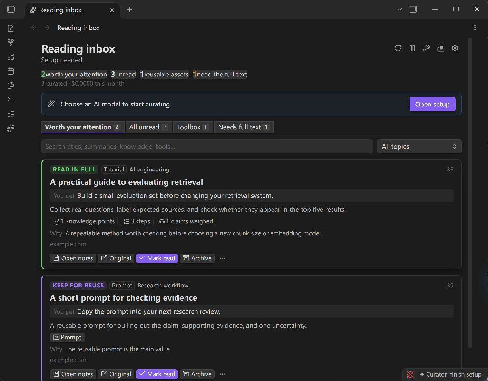

# AI Curator for Obsidian

**尽管收藏，只读重要的。**

*Save anything. Read what matters.*

[English](README.md) · [Obsidian 社区插件](https://community.obsidian.md/plugins/ai-curator) · [版本下载](https://github.com/MartinZhong2026/Obsidian-AI-Curator/releases) · [更新记录](CHANGELOG.md)

AI Curator 是一个免费的开源 Obsidian 插件，适合收藏很多、来不及逐篇阅读的人。选定存放网页剪藏、X 帖子和研究资料的 Markdown 文件夹后，插件会推荐哪些内容值得精读、速览、备查或跳过，并把有用的知识整理成带链接的 Markdown 笔记。

1. **安装。** 在 Obsidian 1.11.4 或更高版本中，打开 **设置 → 第三方插件 → 浏览**，搜索 **AI Curator**，安装并启用。
2. **设置。** 选择来源文件夹，连接并测试模型，先处理最近 10 篇或仅处理新增收藏。默认使用 DeepSeek，需要自己的 API Key。
3. **开始阅读。** 点击左侧 ✦ 图标，或在命令面板打开阅读收件箱。从 **值得关注** 开始读，之后可在 **工具箱** 查找可复用的素材。

*Obsidian 中的 AI Curator 1.1.0 真实界面，使用虚构样例。* [工具箱截图](docs/images/toolbox-1.1.0.jpg) · [待补全原文截图](docs/images/needs-full-text-1.1.0.jpg)

## 从收藏夹到阅读清单

- **知道为什么值得读。** 查看阅读收获、推荐理由及可用的原文证据。评分会考虑内容形态，技术教程和研究文章可以凭各自的价值入选。
- **留下可复用的内容。** 整理笔记包含关键观点、方法、注意事项和后续行动。工具箱汇集带出处的 Prompt、代码、命令、表格、工具与资源。可直接复制的原文片段会与可用正文核对。
- **谨慎处理不完整收藏。** 补全后仍只有导语的内容会放入 **待补全原文**，结论标为暂定。插件可以尝试获取原始网页。通过 FxTwitter 补全 X 帖子和通过 GitHub API 补充仓库资料均需分别开启。
- **保护原始笔记。** 整理结果写入单独的文件夹，原始笔记不会被改写。重新整理会保留阅读状态和分隔标记下的个人笔记。

[中文整理示例](docs/examples/zh/)展示旧版在虚构收藏上的真实模型输出。[演示仓库](demo/vault/)包含可在本地整理的公开样例。

## 升级和备选安装方式

- **社区插件升级。** 打开 **设置 → 第三方插件**，检查更新并在 AI Curator 旁点击 **更新**。1.1.0 会重新检查可能被旧版去重隐藏的收藏。批准付费重新整理前，可先查看费用估算。
- **GitHub ZIP。** 从 [Release 页面](https://github.com/MartinZhong2026/Obsidian-AI-Curator/releases/latest) 下载 `ai-curator-*.zip`。将其中的 `ai-curator` 文件夹解压到 `<仓库>/.obsidian/plugins/`，重启 Obsidian 后启用。手动升级时，只替换已有文件夹内的 `main.js`、`manifest.json` 和 `styles.css`，以保留设置与索引。
- **BRAT。** 在 [BRAT](https://github.com/TfTHacker/obsidian42-brat) 运行 **Add a beta plugin for testing**，输入 `MartinZhong2026/Obsidian-AI-Curator`，然后启用 AI Curator。

## 模型、费用与隐私

支持 DeepSeek、Anthropic Claude、OpenAI、Gemini、OpenRouter、Ollama、LM Studio，以及兼容 OpenAI 的接口。界面与整理笔记可分别选择英文或简体中文。远程模型接口要求 HTTPS，只有本机回环地址允许 HTTP。

插件免费，托管模型可能按请求收费。默认每月预算估算为 3 美元，每日限 100 篇。没有内置价格的模型可以手动填写单价，实际费用以服务商账单为准。

配置的模型会接收 Markdown、标题、来源元数据、主题与标签名称以及可选的阅读偏好。网页正文补全默认开启，遇到仅有导语的收藏时会请求其中的链接。密钥保存在 Obsidian SecretStorage。插件无需账号，无遥测。离线使用时，选择本地模型并关闭网页正文补全、X 补全和 GitHub 仓库补充。[完整隐私与联网说明](docs/PRIVACY.md)

队列需要 Obsidian 保持开启。插件处理 Markdown，无法分析 PDF、图片和视频里的内容。付费墙与登录要求可能妨碍正文恢复，AI 判断与摘要也可能出错。需要确保准确时，请对照原文。

## 反馈与贡献

如果没有开始处理，请检查 **队列**、模型连接和预算限制。也可以运行 **整理当前笔记**，单独试用未纳入监控的文件。

[反馈问题或建议](https://github.com/MartinZhong2026/Obsidian-AI-Curator/issues/new/choose) · [参与贡献](CONTRIBUTING.md) · [MIT 许可证](LICENSE)
